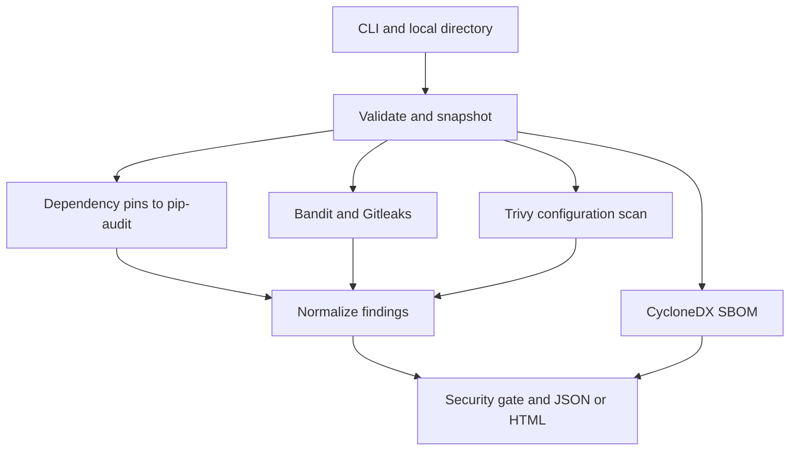

# SecureSupply

Automated Software Supply Chain Security Scanner — DevSecMLOps Internal 1.

Local rule-based auditing of dependency vulnerabilities, Python source, exposed secrets,
Dockerfiles, and supported infrastructure configuration using real tools. No ML dataset or model.

## Problem and objectives
Repository risks come from several sources and tools produce incompatible outputs. SecureSupply
runs independent scanners, normalizes their findings, produces JSON/HTML and CycloneDX reports,
and returns a configurable CI gate result with honest coverage status.

## Architecture


## Stack and layout
Python, packaging, pip-audit with OSV/PyPI, Bandit, Gitleaks 8.30.1,
CycloneDX Python tooling, Trivy 0.75.0, pytest, Ruff, Docker and GitHub Actions.

```text
securesupply/
  securesupply/    CLI, paths, manifests, scanners, normalization, gates, HTML
  tests/          parser, gate, timeout, invalid-input and CLI tests
  examples/safe-repo/  inert Python, pinned dependency and Docker fixture
  scripts/        checksummed Linux CI tool installer
  reports/        actual verification examples (not templates)
  docs/           project report, viva, upload instructions
  .github/workflows/ci.yml
  requirements.txt, requirements-dev.txt, pyproject.toml
  Dockerfile, SECURITY.md, LICENSE, .env.example
```

## Installation
Python 3.11+ is required. Python 3.12 is recommended and was used for local verification.
Run all project commands from the extracted project directory.

macOS/Linux:
```bash
python3 -m venv .venv
source .venv/bin/activate
python -m pip install --upgrade pip setuptools
python -m pip install -r requirements.txt -r requirements-dev.txt -e .
```
Windows PowerShell (no activation required):
```powershell
py -3.12 -m venv .venv
.\.venv\Scripts\python.exe -m pip install --upgrade pip setuptools
.\.venv\Scripts\python.exe -m pip install -r requirements.txt -r requirements-dev.txt -e .
```
On Windows, replace `python` in later commands with `.\.venv\Scripts\python.exe`
and use full `.venv\Scripts` executable paths for Ruff/Bandit when not activated.
Python packages are version-pinned directly. Their transitive dependencies are resolved by pip;
reproduce model inference with the same environment as training. For deployment, generate a reviewed,
platform-specific, fully hashed dependency lock. Dependabot proposes updates; review and retest them.

Install external executables to enable every check:
- macOS: `brew install gitleaks trivy`.
- Linux x64: `python scripts/install_ci_tools.py --destination .tools`, then
  `export PATH="$PWD/.tools:$PATH"`. This downloads pinned official release binaries with checksum verification.
- Windows: download the matching binaries from the official
  [Gitleaks releases](https://github.com/gitleaks/gitleaks/releases) and
  [Trivy releases](https://github.com/aquasecurity/trivy/releases), verify their release checksums,
  extract them, and add their directory to PATH. Gitleaks must support `dir` (8.19+).

Run `bandit --version`, `pip-audit --version`, `cyclonedx-py --version`,
`gitleaks version`, and `trivy --version` to confirm setup. The `.env.example` is informational;
the CLI uses flags, so no secret or dotenv file is necessary.

## Run
Safe included repository, output outside that repository:
```bash
python -m securesupply examples/safe-repo --output reports/latest --timeout 180
```
Scan another project; select a sibling output folder (reports must be outside the target):
```bash
python -m securesupply ../my-project --output ../my-project-audit
```
If OSV is unreachable and PyPI is permitted, explicitly select the supported alternative:
```bash
python -m securesupply examples/safe-repo --output reports/latest --vulnerability-service pypi
```
Offline demonstration of the Python/SBOM checks with an explicitly smaller gate:
```bash
python -m securesupply examples/safe-repo --output reports/local-only --tools bandit sbom --require bandit sbom
```
Inspect `report.html` in a browser and `report.json` in any JSON reader. An optional dashboard
was omitted because the self-contained HTML already presents check status and normalized findings.

Configurable gate example:
```bash
python -m securesupply ../my-project --output ../audit --fail-on MEDIUM --timeout 120
```
`--manifest requirements.lock` selects a flat exact-pinned file. `uv.lock` and `poetry.lock` are
supported only when all records declare registry package versions; a virtual/local project, URL or
editable record requires a registry-only export first. Requirements ranges, recursive `-r`, options,
URLs, editable installs, and pip hash continuations are rejected. Environment marker variants are
all audited conservatively; platform-specific findings may need review.

Default manifest search: requirements.txt, then uv.lock, then poetry.lock. Only the selected manifest
is audited. Requirements with direct pins alone cover those declarations, not undisclosed transitive
versions; provide a complete pinned resolved manifest for full declared dependency coverage. No
package installation or arbitrary repository code execution occurs. The command uses
`pip-audit --no-deps --disable-pip --strict` on a sanitized temporary manifest. SBOM contents reflect
these same declarations, not a verified installed runtime or complete dependency relationship graph.

## Findings and exit codes
| Status | Meaning |
|---|---|
| passed | Tool completed and produced no findings; SBOM successfully generated |
| failed | Tool completed with findings, even when below the chosen gate threshold |
| skipped | Tool not selected, or no applicable supported dependency manifest |
| unavailable | Executable not present |
| error | Timeout, invalid manifest/output, scanner failure, network failure, or partial analysis |

Exit 0 means the **configured** gate passed; it does not mean every possible risk was scanned.
Exit 1 means a finding breached the threshold. Exit 2 means invalid input or an incomplete required
check. Findings take precedence over incomplete coverage when both occur; inspect all check statuses.
All five checks are required by default. An explicit `--require` list can narrow the coverage contract.
Pip-audit findings use UNKNOWN severity because uniform CVSS is not available in its JSON;
UNKNOWN blocks by default. `--allow-unknown` is an explicit policy relaxation. Duplicate findings
from different tools retain attribution rather than being silently suppressed.

Bandit parses Python without executing it. Gitleaks scans current copied files, not history;
the dedicated CI job scans git history separately. Gitleaks secret strings and source snippets
are discarded. Trivy uses filesystem misconfiguration analysis of Dockerfiles, Kubernetes,
Terraform and other supported configuration; it does not build images or assess a running container.
Image scanning can be done separately with `trivy image IMAGE`, requiring a registry/cache and image.
Scanner stderr is discarded to avoid leaking secret fragments; incomplete reports identify the check
and exit status. Run tools directly on a trusted safe fixture when diagnosing connectivity.

## Vulnerability sources
- [OSV API](https://google.github.io/osv.dev/api/) is the default pip-audit backend. Only declared
  package/version metadata is queried; no massive database is downloaded.
- [PyPI advisory backend](https://github.com/pypa/pip-audit) is available through an explicit flag.
- [NVD](https://nvd.nist.gov/) is a reference for CVEs; this implementation does not directly query it.
  Do not claim NVD integration or invented CVSS enrichment. NVD requests have published rate limits
  (5/30 seconds without a key, 50/30 with a key) if an enrichment module is added in future.
- OSV does not publish a fixed general quota in its current API guidance; use sensible request volumes,
  honor upstream errors, and rerun later if limited. The outer per-tool timeout bounds a failed audit.
- Trivy misconfiguration rules may require a first-run rules download; its vulnerability database is
  not requested by the misconfiguration-only command. Offline use requires cached rule bundles.

## Tests and verified results
```bash
python -m pytest -q
ruff check .
ruff format --check .
bandit -r securesupply scripts -ll
```
See [reports/VERIFICATION.md](reports/VERIFICATION.md) for actual local outcomes, tool versions,
limitations and generated report evidence. Parser unit tests use controlled fixtures to exercise error
paths; report examples come from actual tool invocations. No synthetic vulnerabilities are claimed.

## Docker
```bash
docker build -t securesupply .
docker run --rm -v "$PWD/examples/safe-repo:/scan:ro" -v "$PWD/reports:/out" securesupply /scan --output /out/latest --tools bandit sbom --require bandit sbom
```
Host output directories must be writable by container UID 10001. PowerShell users can use absolute
paths for both mounts. This image includes the Python tools; Gitleaks and Trivy require a reviewed
custom image layer or host installation. The command above explicitly declares the smaller gate.
Docker builds were not run locally if Docker is absent; CI includes a real build step.

## Limitations and improvements
Snapshotting caps 10,000 files and 100 MB, excludes symlinks, tool configuration, common build folders,
models and reports. Inspect recorded scope. Keep the source tree unchanged during the scan; this is
not a hostile-file OS sandbox and does not defend against concurrent filesystem replacement.
Scanning tools must be trusted and patched. Analysis can have false positives and false negatives.
Future work: isolated container execution, OSV CVSS enrichment with provenance, full resolved
SBOM relationships, suppression expiry, history scanning in the CLI, and reviewed additional SAST rules.

[Academic report](docs/PROJECT_REPORT.md) · [Viva](docs/VIVA.md) ·
[GitHub upload instructions](docs/GITHUB.md) · [Security policy](SECURITY.md)
